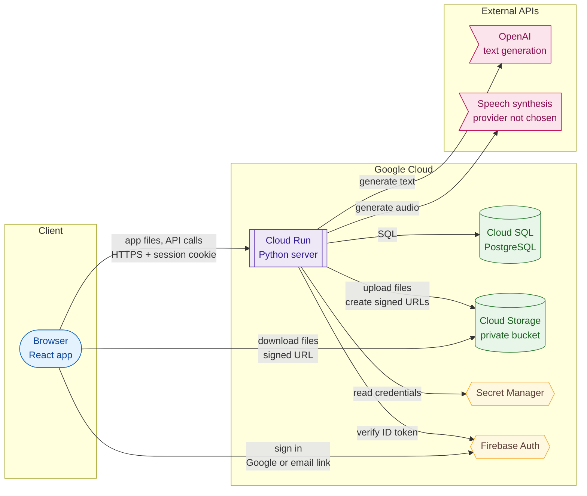

# Architecture: system overview

The layout of the services the system runs on and the layout of its data. This document is updated when a service or data store is added or changes.

## Service layout

Node shapes by type: rounded = client, double-bordered box = compute, cylinder = data store, hexagon = managed service, flag = external API. Arrows point from the caller to the service it calls.

| Service | Platform | Role |
|---|---|---|
| React app | Browser, served by the Python server | User interface |
| Python server | Google Cloud Run | Serves the app and the API |
| Database | Google Cloud SQL for PostgreSQL | All structured data |
| File store | Google Cloud Storage, private bucket | Generated files (videos, audio) |
| Identity | Firebase Auth (Google) | Verifies who a user is at sign-in (Google sign-in or email link) |
| Secrets | Google Secret Manager | OpenAI key, database password |
| AI | OpenAI | Generates text on request |
| Speech synthesis | Not chosen yet | Generates audio on request |

- The browser talks to three services: the Python server for the app and all data, Firebase Auth to sign in, and Cloud Storage only to download a file through a signed URL the server created. It never reaches the database, Secret Manager, or the external APIs.
- The server holds no state between requests; everything lives in Cloud SQL and Cloud Storage. Any Cloud Run instance can serve any request, so instances can be added or removed freely.
- Calls to the external APIs go out from the server only, with credentials from Secret Manager.

## Code layout

Where the code for each service lives, so a change can be traced to the files it touches. Paths are relative to the repository root.

| Service | Code | Build and deploy |
|---|---|---|
| React app | `app.jsx` (source), `index.html` | `npm run build` bundles `app.jsx` into `app.js` with esbuild; `app.js` is build output and not committed |
| Python server | `server.py`, `requirements.txt` | Runs as `python server.py`; also serves `index.html` and `app.js` |
| Cloud Run image | `Dockerfile`, `.dockerignore` | Builds the React app, then packages it with the Python server into one image |
| Cloud SQL schema | not implemented yet | Versioned migrations, run before the new version takes traffic |
| Cloud Storage, Secret Manager, Firebase Auth | not implemented yet | Configured in Google Cloud; accessed only from `server.py` |

When code is split into more files or directories, update this table in the same change.

## Data layout

| Store | What it holds | Format |
|---|---|---|
| Cloud SQL | Accounts, users, sessions, task lists, and tasks with their content and results | Relational tables; task content and results as `jsonb` columns |
| Cloud Storage | Generated media files | Objects under fixed keys, for example `tasks/<task_id>/...` |
| Firebase Auth | Sign-in identities | Managed by Firebase; linked to a database user by its Firebase user ID |
| Secret Manager | Credentials | Secret values, read only by the server |
| Browser | Only the session cookie | `HttpOnly` cookie; no data is stored in the browser |

- **The database is the source of truth.** A file in Cloud Storage is only reachable through a reference (its object key) stored in the database. The database stores keys, not URLs.
- **Files reach the browser through short-lived signed URLs** created by the server, so the bucket stays private.
- **Writes to the database and the bucket are ordered:** a file is uploaded before its key is saved, so a saved key always points to an existing file. Files left without a key are removed by a scheduled cleanup.

## Reliability and operations

- **Backups:** Cloud SQL automated daily backups and point-in-time recovery, so the database can be restored to any moment in the retention window.
- **Schema migrations:** versioned migrations (for example Alembic), run as a deploy step before the new version takes traffic.
- **Secrets** stay in Secret Manager, never in code or the browser.
- **Scaling:** Cloud Run adds and removes server instances with traffic.
