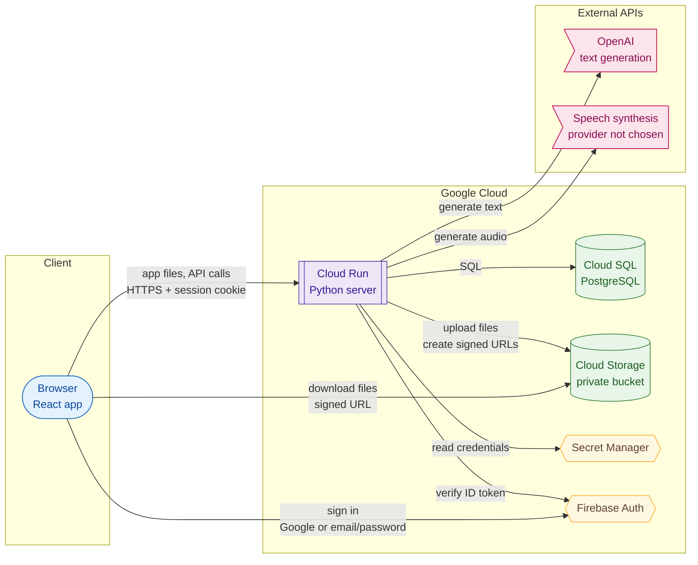

# Architecture: system overview

The layout of the services the system runs on and the layout of its data. This document is updated when a service or data store is added or changes.

## Service layout

Node shapes by type: rounded = client, double-bordered box = compute, cylinder = data store, hexagon = managed service, flag = external API. Arrows point from the caller to the service it calls.

| Service | Platform | Role |
|---|---|---|
| React app | Browser, served by the Python server | User interface |
| Python server | Google Cloud Run | Serves the app and the API |
| Database | Google Cloud SQL for PostgreSQL | All structured data |
| File store | Google Cloud Storage, private bucket | Generated files (videos, audio) |
| Identity | Firebase Auth (Google) | Verifies who a user is at sign-in (Google or email/password) |
| Secrets | Google Secret Manager | OpenAI key, database password, Firebase credentials |
| AI | OpenAI | Generates text on request |
| Speech synthesis | Not chosen yet | Generates audio on request |

- The browser talks to three services: the Python server for the app and all data, Firebase Auth to sign in, and Cloud Storage only to download a file through a signed URL the server created. It never reaches the database, Secret Manager, or the external APIs.
- The server holds no state between requests; everything lives in Cloud SQL and Cloud Storage. Any Cloud Run instance can serve any request, so instances can be added or removed freely.
- Calls to the external APIs go out from the server only, with credentials from Secret Manager.
- Local development can replace Firebase with `AUTH_DEV_MODE=1` (HMAC-signed development tokens) and Postgres in Docker Compose.

## Code layout

Where the code for each service lives, so a change can be traced to the files it touches. Paths are relative to the repository root.

| Service | Code | Build and deploy |
|---|---|---|
| React app | `app.jsx`, `auth-ui.jsx`, `index.html` | `npm run build` bundles into `app.js` (git-ignored) |
| Python server | `server.py`, `auth/`, `requirements.txt` | Runs as `python server.py`; serves `index.html` and `app.js` |
| Auth feature | `auth/db.py`, `auth/identity.py`, `auth/service.py`, `auth/api.py` | Session cookie + `/api/auth/*` |
| Cloud Run image | `Dockerfile`, `.dockerignore`, `docker-compose.yml` | Builds the React app, then packages it with the Python server |
| Cloud SQL schema | `migrations/*.sql` | Applied automatically on server start |
| Config and scripts | `env/*.env`, `scripts/lib.sh` (shared helpers), `scripts/deploy-cloud-run.sh`, `scripts/dev-firebase.sh`, `scripts/upsert-secret.sh` | Env layout in `env/README.md`; script usage and cloud setup in `scripts/README.md` |
| Tests | `tests/conftest.py`, `tests/test_auth_scenarios.py`, `pytest.ini`, `requirements-dev.txt` | Pytest against Docker Postgres |
| Cloud Storage, Secret Manager, Firebase Auth | configured in Google Cloud; Admin SDK used from `auth/identity.py` | One-time setup in `scripts/README.md` |

When code is split into more files or directories, update this table in the same change.

## Data layout

| Store | What it holds | Format |
|---|---|---|
| Cloud SQL | Users, accounts, guardian requests, sessions; later task lists and tasks | Relational tables; task content and results as `jsonb` columns |
| Cloud Storage | Generated media files | Objects under fixed keys, for example `tasks/<task_id>/...` |
| Firebase Auth | Sign-in identities | Managed by Firebase; linked to a database user by `user.firebase_uid` |
| Secret Manager | Credentials | Secret values; read by the server at runtime, and the Firebase Admin key by `scripts/dev-firebase.sh` with the developer's gcloud login (never written to disk) |
| Browser | Only the session cookie (plus Firebase SDK state while signing in) | `HttpOnly` app session cookie; no account data is stored in `localStorage` for auth |

- **The database is the source of truth.** A file in Cloud Storage is only reachable through a reference (its object key) stored in the database. The database stores keys, not URLs.
- **Files reach the browser through short-lived signed URLs** created by the server, so the bucket stays private.
- **Writes to the database and the bucket are ordered:** a file is uploaded before its key is saved, so a saved key always points to an existing file. Files left without a key are removed by a scheduled cleanup.

## Reliability and operations

- **Backups:** Cloud SQL automated daily backups and point-in-time recovery, so the database can be restored to any moment in the retention window.
- **Schema migrations:** versioned SQL files in `migrations/`, applied on process start before serving traffic.
- **Secrets** stay in Secret Manager, never in code or the browser.
- **Scaling:** Cloud Run adds and removes server instances with traffic.
- **Sessions:** cookie stores a random token; only the SHA-256 hash is stored. Expired/revoked sessions older than 30 days can be deleted (`AuthService.cleanup_sessions`).
